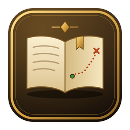
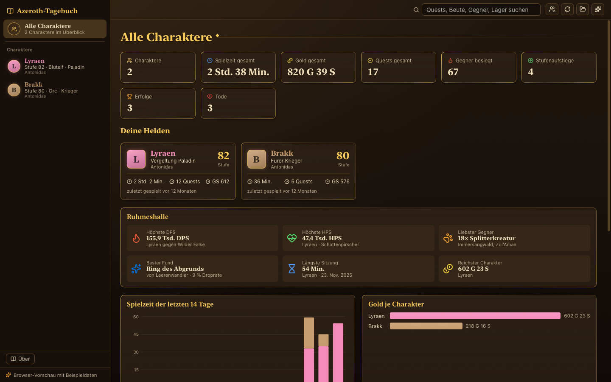
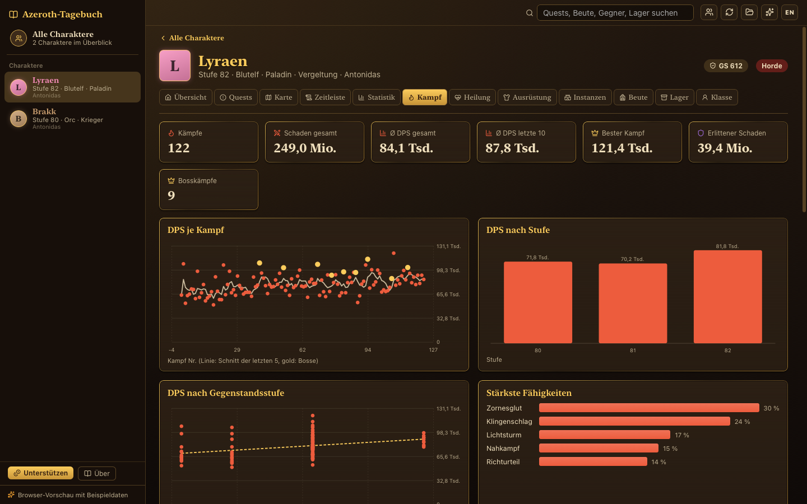
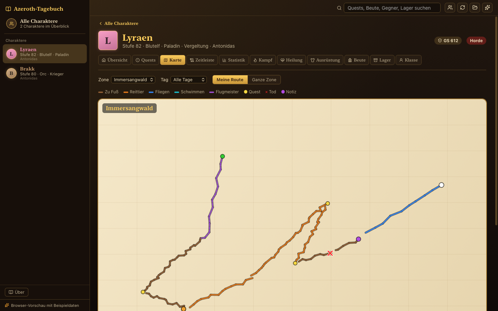
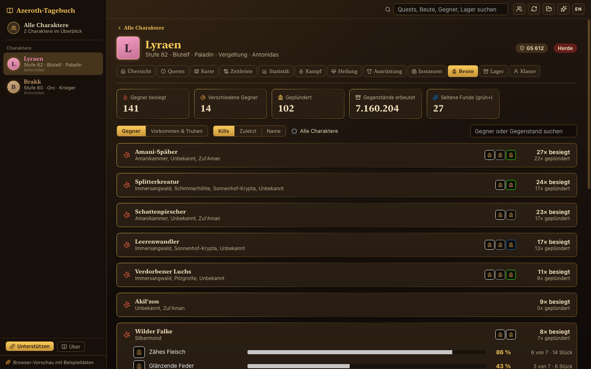
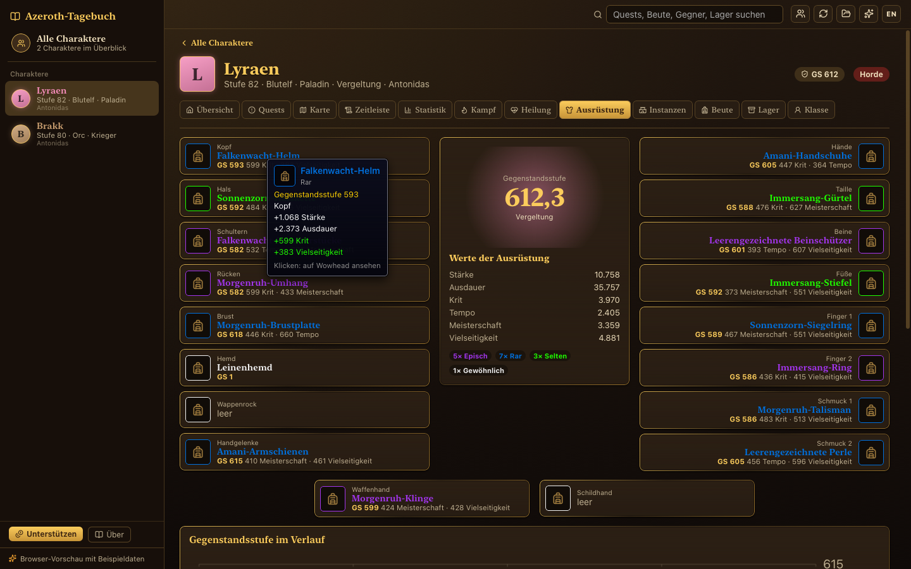
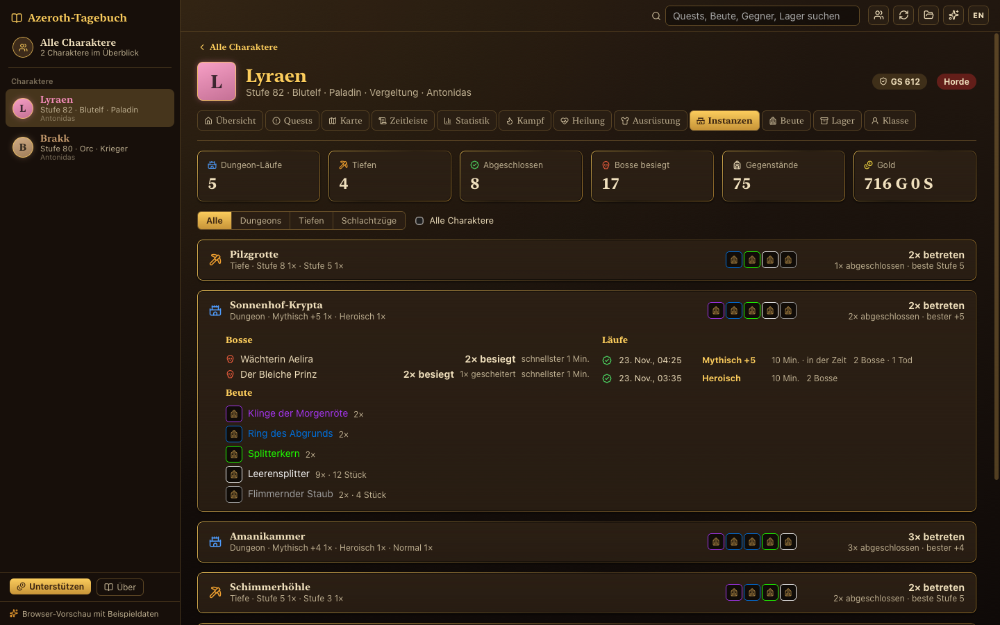
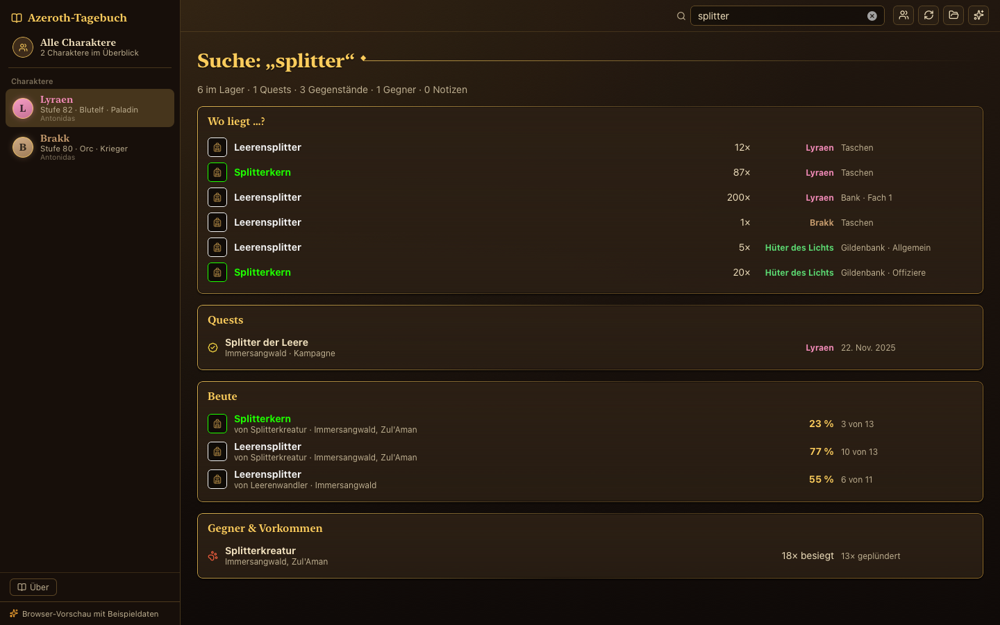
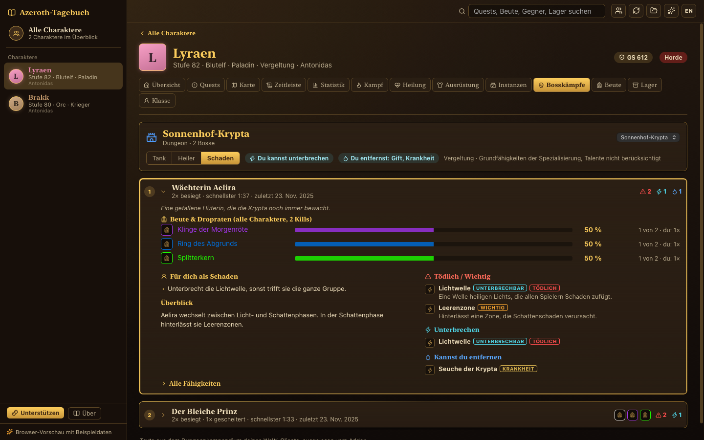

<p align="center">
  
</p>

<h1 align="center">Azeroth-Tagebuch</h1>

<p align="center">
  <b>Das Tagebuch für deine World-of-Warcraft-Charaktere</b><br>
  Quests, Reisewege, Kämpfe, Beute und Lager – automatisch mitgeschrieben, schön aufbereitet.
</p>

<p align="center">
  <a href="https://github.com/dirkkredinger/azeroth-tagebuch/releases/latest"><b>⬇ Herunterladen</b></a> ·
  <a href="https://www.curseforge.com/wow/addons/azeroth-tagebuch">CurseForge</a> ·
  <a href="#installation">Installation</a> ·
  <a href="#häufige-fragen">Fragen</a> ·
  <a href="https://github.com/dirkkredinger/azeroth-tagebuch/issues">Fehler melden</a> ·
  <a href="https://ko-fi.com/mbmf17/">☕ Unterstützen</a> ·
  <a href="README.md">🇬🇧 English</a>
</p>



## Was es kann

Ein kleines **Addon** schreibt im Spiel mit, was deine Charaktere erleben. Die **App** auf deinem Rechner
liest das automatisch ein und zeigt es als Tagebuch und Dashboard – während du spielst sogar live.

- **Account-Übersicht** mit Ruhmeshalle, Spielzeit, Gold und den letzten Ereignissen aller Charaktere
- **Quests**, **Zeitleiste** und **Statistik** pro Charakter
- **Karte** mit deiner Route – eingefärbt nach Fortbewegung, mit Quests, Toden und Notizen
- **Kampf und Heilung** aus dem offiziellen Kampflog: DPS/HPS je Kampf, nach Stufe und nach Gegenstandsstufe
- **Ausrüstung** als Charakterbogen mit Werten und Wechselverlauf
- **Dungeons, Tiefen und Schlachtzüge**: wie oft betreten und abgeschlossen, welche Bosse gefallen sind, Tiefenstufe bzw. Schlüsselstein und die Beute je Instanz
- **Bosskämpfe**: geht beim Betreten eines Dungeons oder Schlachtzugs von selbst auf – Hinweise aus dem Dungeonkompendium für deine Rolle, was deine Spezialisierung unterbrechen oder entfernen kann, und deine eigene Bilanz je Boss
- **Beute mit Dropraten**: welcher Gegner was wie oft fallen lässt
- **Lager**: Taschen, Bank, Kriegsmeutenbank und Gildenbank – und die Suche „**Wo liegt …?**“
- **Klasse & Spezialisierung** mit Links zu Guides und deinem Talent-Build
- Eigenes Design im Stil alter Abenteuerbücher, Item-Tooltips im WoW-Stil
- Auf **Deutsch und Englisch** (folgt der Systemsprache, umschaltbar oben rechts)

| | |
|---|---|
|  |  |
|  |  |
|  |  |
|  | |

<sub>Die Bilder zeigen Beispieldaten und selbst gezeichnete Karten. In der App siehst du die echten Zonenkarten aus deiner eigenen WoW-Installation.</sub>

## Installation

1. **[Neueste Version herunterladen](https://github.com/dirkkredinger/azeroth-tagebuch/releases/latest)** – unter „Assets“:
   - `AzerothTagebuch-Addon-….zip` – das Addon (für alle)
   - **Mac:** `Azeroth-Tagebuch_…_universal.dmg` (Apple-Chip und Intel) – oder per Homebrew: `brew install --cask dirkkredinger/tap/azeroth-tagebuch`
   - **Windows:** `Azeroth-Tagebuch_…_x64-setup.exe`
2. **Addon:** am einfachsten über [CurseForge](https://www.curseforge.com/wow/addons/azeroth-tagebuch) (CurseForge-App oder Download dort). Oder von Hand: ZIP entpacken, den Ordner `AzerothTagebuch` nach `World of Warcraft/_retail_/Interface/AddOns/` kopieren und im Spiel aktivieren.
3. **App installieren.** Sie ist (noch) nicht signiert:
   - **Mac:** in „Programme“ ziehen, beim ersten Start **Rechtsklick → Öffnen**.
   - **Windows:** bei der SmartScreen-Warnung **„Weitere Informationen“ → „Trotzdem ausführen“**.
4. Im Spiel einmal `/reload` – fertig. Liegt WoW nicht am Standardort, wählst du in der App über das Ordner-Symbol den Ordner `_retail_`.

Ohne WoW lässt sich die App über „Beispieldaten anzeigen“ ausprobieren.

**Im Spiel:** `/tb` zeigt eine kurze Statistik, `/tb notiz <Text>` schreibt eine eigene Tagebuchnotiz,
`/tb kampflog an|aus` schaltet das Kampflog für die Kampfstatistik.

## Häufige Fragen

**Kann ich dafür gebannt werden?**
Das Addon schreibt nur mit und automatisiert nichts – wie jedes Statistik-Addon. Die App liest ausschließlich
Dateien von deiner Festplatte (die gespeicherten Addon-Daten, das offizielle Kampflog und die Spieldaten für
Karten und Symbole). Sie greift nie auf das laufende Spiel zu, sendet keine Eingaben und verändert nichts.
Der Quellcode ist offen – jeder kann das nachprüfen.

**Woher kommen Karten und Item-Symbole?**
Aus deiner eigenen WoW-Installation. Die App liefert keine Blizzard-Grafiken mit, sondern liest sie bei Bedarf
lokal aus und speichert sie nur auf deinem Rechner.

**Werden meine Daten irgendwohin geschickt?**
Nein. Alles bleibt auf deinem Rechner.

**Warum stehen manche Namen auf Englisch (oder Deutsch)?**
Quests, Zonen und Gegenstände speichert WoW in der Sprache deines Spiel-Clients. Die Texte der App selbst folgen der Sprache, die du wählst.

**Warum zeigt die Kampfstatistik nichts?**
Sie entsteht aus dem Kampflog, das das Addon beim Einloggen einschaltet. Kämpfe vor der Installation fehlen daher.

## Unterstützen

Das Azeroth-Tagebuch ist kostenlos und quelloffen. Wenn es dir gefällt, freue ich mich über einen Kaffee:

<p align="center"><a href="https://ko-fi.com/mbmf17/"></a></p>

Genauso hilft ein Stern ⭐ hier auf GitHub, eine Fehlermeldung oder eine Idee unter [Issues](https://github.com/dirkkredinger/azeroth-tagebuch/issues).

## Für Entwickler

| Ordner | Inhalt |
|---|---|
| `Addon/AzerothTagebuch` | WoW-Addon (Lua) |
| `app/` | App mit Tauri 2 + Svelte 5 (macOS, Windows; geplant: Android, iOS, Web) |
| `kern/` | Rust: liest SavedVariables und Kampflog, führt alles im Archiv zusammen |
| `wowbilder/` | Rust: Kartenbilder und Symbole aus der lokalen Installation (CascLib) |
| `Sources/`, `Package.swift` | erste Mac-App (SwiftUI), wird abgelöst |
| `tools/` | erzeugt Beispieldaten (`make_sample.py`, `sample_en.py`) und die selbst gezeichneten Beispielkarten (`make_demo_maps.py`) |

```bash
cd app
npm install
npm run tauri dev      # App mit automatischem Neuladen (braucht Rust und Node.js)
npm run tauri build    # fertige App
npm run dev            # nur die Oberfläche im Browser, mit Beispieldaten
```

Tests des Kerns: `cd kern && cargo test`. GitHub Actions baut bei jedem Push Windows- und Mac-Version;
ein Tag `v…` veröffentlicht ein Release mit App und Addon. Texte der Oberfläche: Der deutsche Text ist der Schlüssel,
die englische Übersetzung steht in `app/src/lib/sprache/en.ts`.

## Lizenz

[GNU GPL v3.0](LICENSE) – Fremd-Code und Hinweise siehe [THIRD_PARTY.md](THIRD_PARTY.md).

*World of Warcraft ist eine Marke von Blizzard Entertainment, Inc. Dies ist ein inoffizielles Fan-Projekt
und steht in keiner Verbindung zu Blizzard Entertainment.*

<sub>Entwickelt von dirkkredinger – mit Unterstützung von Claude (Anthropic).</sub>
