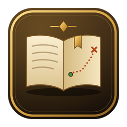
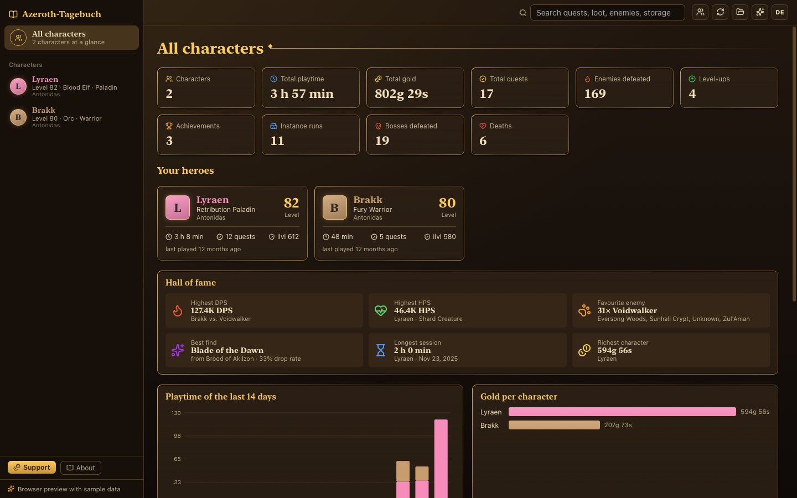
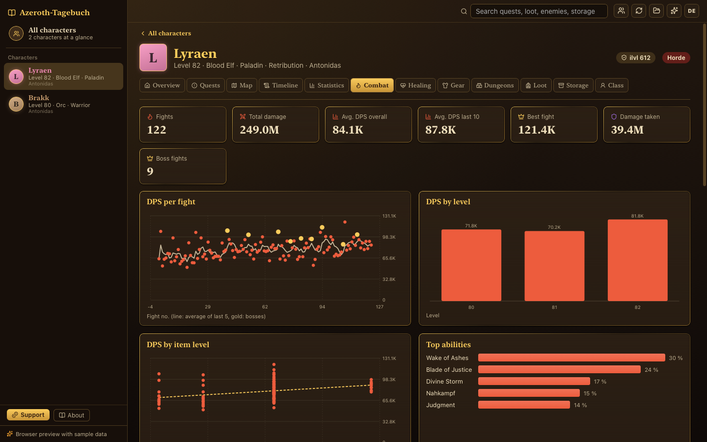
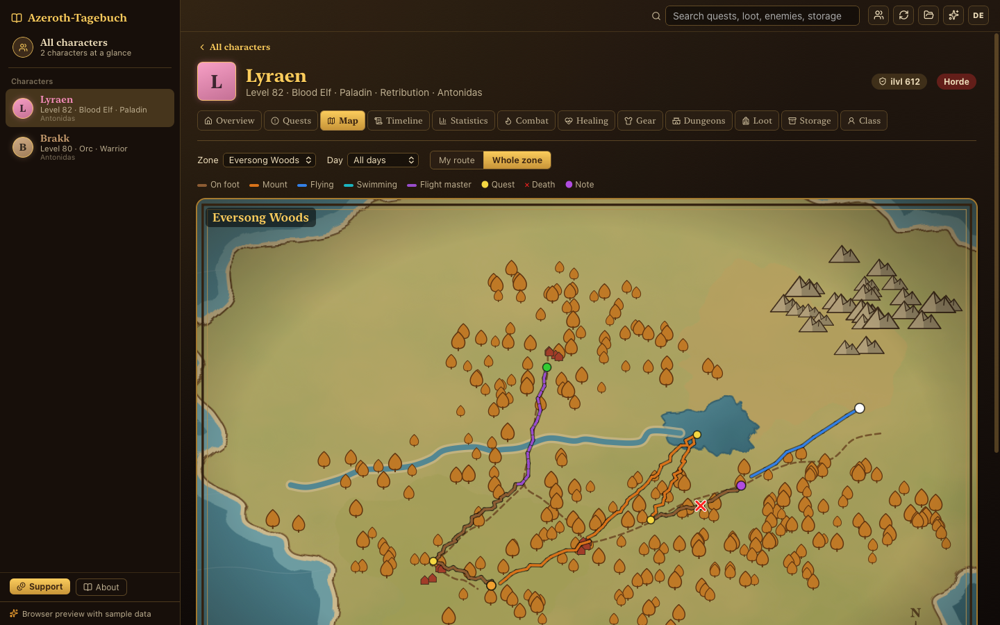
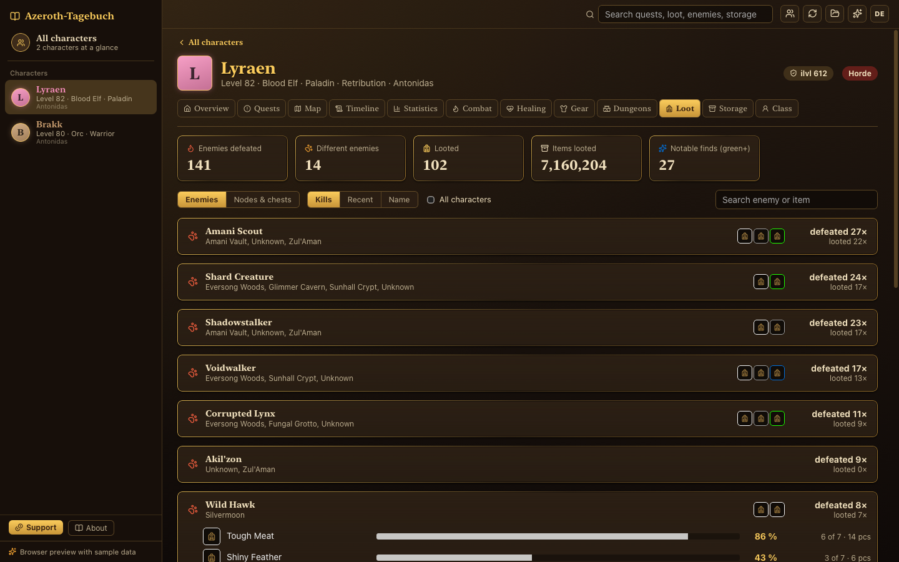
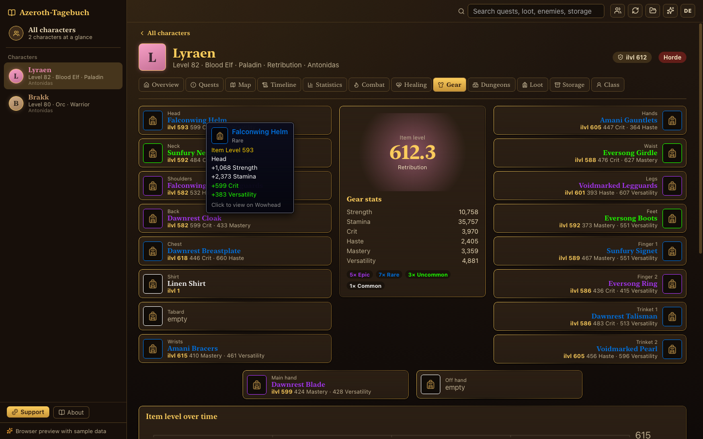
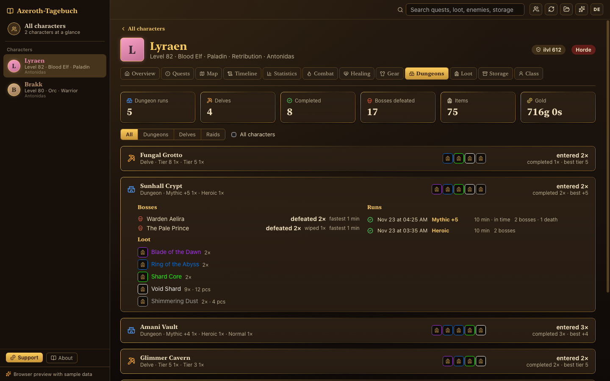
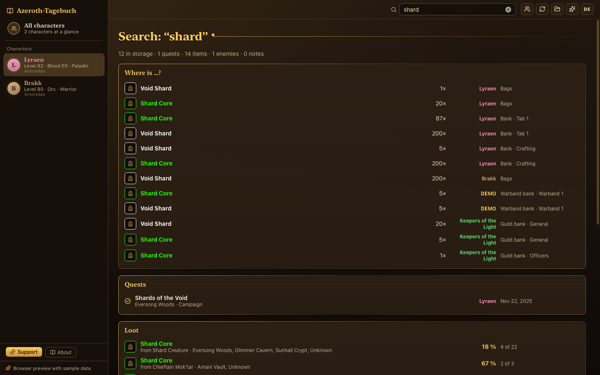
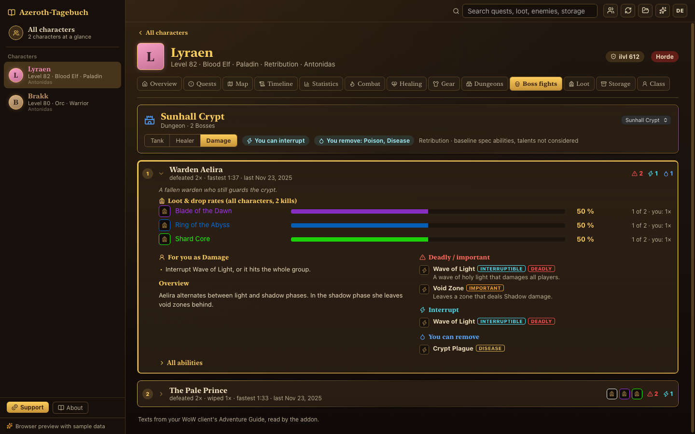

<p align="center">
  
</p>

<h1 align="center">Azeroth-Tagebuch</h1>

<p align="center">
  <b>The adventure journal for your World of Warcraft characters</b><br>
  Quests, travels, fights, dungeons, loot and storage – recorded automatically, presented beautifully.
</p>

<p align="center">
  <a href="https://github.com/dirkkredinger/azeroth-tagebuch/releases/latest"><b>⬇ Download</b></a> ·
  <a href="#installation">Installation</a> ·
  <a href="#faq">FAQ</a> ·
  <a href="https://github.com/dirkkredinger/azeroth-tagebuch/issues">Report a bug</a> ·
  <a href="https://ko-fi.com/mbmf17/">☕ Support</a> ·
  <a href="README.de.md">🇩🇪 Deutsch</a>
</p>



## What it does

A small **addon** records in the game what your characters experience. The **app** on your computer
reads it automatically and shows it as a journal and dashboard – even live while you play.

- **Account overview** with hall of fame, playtime, gold and the latest events of all characters
- **Quests**, **timeline** and **statistics** per character
- **Map** with your route – colored by travel mode, with quests, deaths and notes
- **Combat and healing** from the official combat log: DPS/HPS per fight, by level and by item level
- **Gear** as a character sheet with stats and change history
- **Dungeons, delves and raids**: how often entered and completed, which bosses fell, delve tier or keystone level, and the loot per instance
- **Boss fights**: opens by itself when you enter a dungeon or raid – boss notes from the in-game Adventure Guide for your role, what your spec can interrupt or remove, and your own record against each boss
- **Loot with drop rates**: which enemy drops what and how often
- **Storage**: bags, bank, warband bank and guild bank – plus “**Where is …?**” search
- **Class & specialization** with links to guides and your talent build
- Its own design in the style of old adventure books, WoW-style item tooltips
- In **English and German** (follows your system language, switch at the top right)

| | |
|---|---|
|  |  |
|  |  |
|  |  |
|  | |

<sub>The pictures show sample data and hand-drawn maps. In the app you see the real zone maps from your own WoW installation.</sub>

## Installation

1. **[Download the latest version](https://github.com/dirkkredinger/azeroth-tagebuch/releases/latest)** – under “Assets”:
   - `AzerothTagebuch-Addon-….zip` – the addon (for everyone)
   - **Mac:** `Azeroth-Tagebuch_…_universal.dmg` (Apple silicon and Intel) – or via Homebrew: `brew install --cask dirkkredinger/tap/azeroth-tagebuch`
   - **Windows:** `Azeroth-Tagebuch_…_x64-setup.exe`
2. **Addon:** unzip, copy the `AzerothTagebuch` folder to `World of Warcraft/_retail_/Interface/AddOns/` and enable it in the game.
3. **Install the app.** It is not signed (yet):
   - **Mac:** drag it to “Applications”, on first launch **right-click → Open**.
   - **Windows:** at the SmartScreen warning choose **“More info” → “Run anyway”**.
4. Type `/reload` once in the game – done. If WoW is not in its default location, pick the `_retail_` folder via the folder icon in the app.

Without WoW you can try the app with “Show sample data”.

**In the game:** `/tb` shows a short summary, `/tb notiz <text>` writes your own journal note,
`/tb kampflog an|aus` turns the combat log for the combat statistics on or off.

## FAQ

**Can I get banned for this?**
The addon only records and automates nothing – like any statistics addon. The app only reads files on your
disk (the saved addon data, the official combat log and the game data for maps and icons). It never touches the
running game, sends no input and changes nothing. The source code is open – anyone can check.

**Where do maps and item icons come from?**
From your own WoW installation. The app ships no Blizzard graphics; it reads them locally when needed and
stores them only on your computer.

**Is my data sent anywhere?**
No. Everything stays on your computer.

**Why are names in the app in German (or English)?**
Quests, zones and items are stored in the language of your WoW client. The app’s own texts follow the language you choose.

**Why are the combat statistics empty?**
They come from the combat log, which the addon turns on when you log in. Fights before installing are therefore missing.

## Support

Azeroth-Tagebuch is free and open source. If you like it, I’d be happy about a coffee:

<p align="center"><a href="https://ko-fi.com/mbmf17/"></a></p>

A star ⭐ here on GitHub, a bug report or an idea under [Issues](https://github.com/dirkkredinger/azeroth-tagebuch/issues) helps just as much.

## For developers

| Folder | Contents |
|---|---|
| `Addon/AzerothTagebuch` | WoW addon (Lua) |
| `app/` | App built with Tauri 2 + Svelte 5 (macOS, Windows; planned: Android, iOS, web) |
| `kern/` | Rust: reads SavedVariables and the combat log, merges everything into the archive |
| `wowbilder/` | Rust: map images and icons from the local installation (CascLib) |
| `Sources/`, `Package.swift` | first Mac app (SwiftUI), being replaced |
| `tools/` | generates sample data (`make_sample.py`, `sample_en.py`) and the hand-drawn sample maps (`make_demo_maps.py`) |

```bash
cd app
npm install
npm run tauri dev      # app with hot reload (needs Rust and Node.js)
npm run tauri build    # release build
npm run dev            # UI only, in the browser, with sample data
```

Core tests: `cd kern && cargo test`. GitHub Actions builds the Windows and Mac versions on every push;
a `v…` tag publishes a release with app and addon. UI texts: German is the key, English lives in
`app/src/lib/sprache/en.ts`.

## License

[GNU GPL v3.0](LICENSE) – third-party code and notices see [THIRD_PARTY.md](THIRD_PARTY.md).

*World of Warcraft is a trademark of Blizzard Entertainment, Inc. This is an unofficial fan project
and is not affiliated with Blizzard Entertainment.*

<sub>Developed by dirkkredinger – with the help of Claude (Anthropic).</sub>
